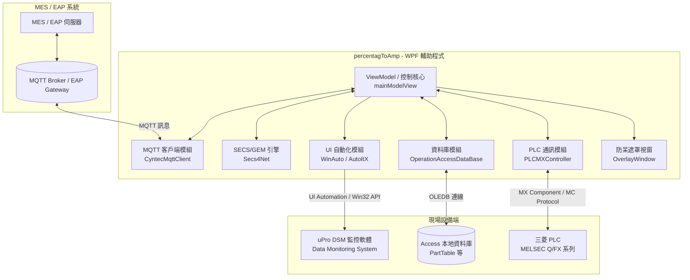
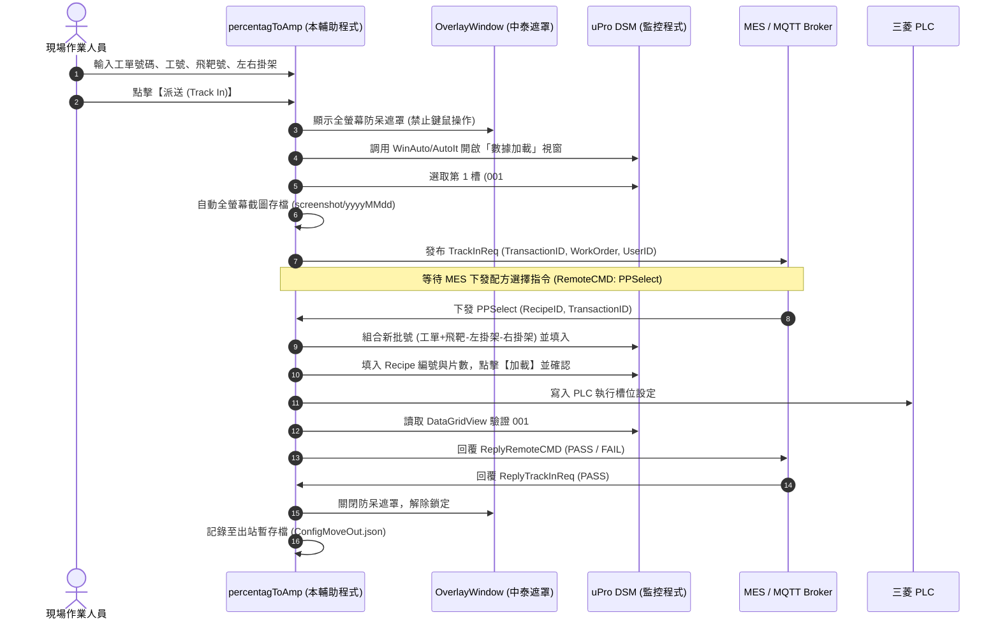
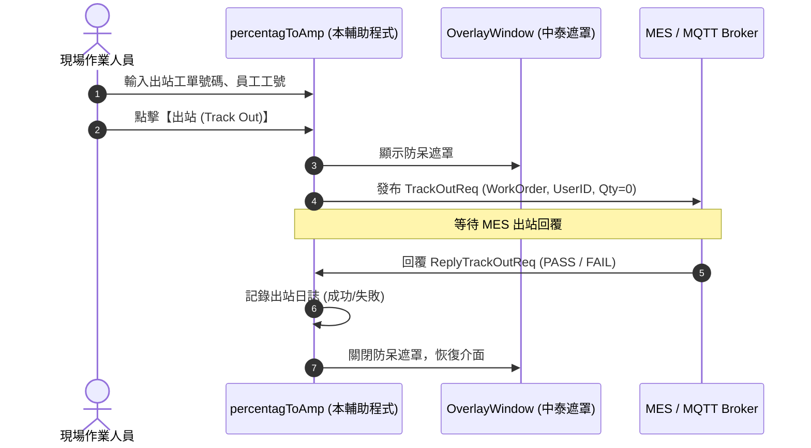

# uPro DSM 電鍍製程自動化助手 (Uproplatehelper / percentagToAmp)

本專案為針對 **Cyntec (乾坤科技)** 電鍍產線所開發之自動化外掛輔助系統（主要服務於泰國 TN2 廠區等生產線）。專案整合了上位製造執行系統（**MES / EAP**）、現場機台人機監控軟體（**uPro DSM - Data Monitoring System**）以及底層三菱 **PLC**，旨在實現**工單自動進站 (Track In)**、**自動出站 (Track Out)**、**Recipe 配方自動下載載入 (PPSelect / LoadRecipe)** 以及**機台狀態與能耗數據監控回報**。

---

## 目錄 (Table of Contents)

1. [專案架構與定位](#1-專案架構與定位)
2. [系統架構與流程圖](#2-系統架構與流程圖)
3. [專案目錄與模組職責](#3-專案目錄與模組職責)
4. [核心功能模組詳解](#4-核心功能模組詳解)
   - [4.1 通訊架構 (MQTT & SECS/GEM)](#41-通訊架構-mqtt--secsgem)
   - [4.2 UI 自動化控制 (WinAuto & AutoIt)](#42-ui-自動化控制-winauto--autoit)
   - [4.3 防呆機制與全螢幕遮罩 (OverlayWindow)](#43-防呆機制與全螢幕遮罩-overlaywindow)
   - [4.4 PLC 數據採集與連線管理 (PLCController)](#44-plc-數據採集與連線管理-plccontroller)
   - [4.5 本地 Access 配方資料庫管理](#45-本地-access-配方資料庫管理)
   - [4.6 出站工單歷程快取 (ConfigMoveOut)](#46-出站工單歷程快取-configmoveout)
   - [4.7 視窗探查輔助工具 (winspy)](#47-視窗探查輔助工具-winspy)
5. [開發與運行環境 (Prerequisites)](#5-開發與運行環境-prerequisites)
6. [設定檔說明 (Configuration)](#6-設定檔說明-configuration)
7. [版本演進歷史 (Version History)](#7-版本演進歷史-version-history)
8. [維護與操作注意事項 (Troubleshooting)](#8-維護與操作注意事項-troubleshooting)

---

## 1. 專案架構與定位

在傳統電鍍生產過程中，現場作業人員需手動於機台監控軟體（WinForms `Data Monitoring System`）內鍵入批號、資料編號、片數，並由人工手動向 MES 執行進出站，容易衍生人為輸入錯誤或操作延誤。

**Uproplatehelper (percentagToAmp)** 作為外掛橋樑軟體，達到以下目的：
- **雙向通訊整合**：透過 MQTT 通訊協議（相容 SECS/GEM 模式）與 MES/EAP 對接，接收生產指令並回報設備即時狀態。
- **自動化視窗控制**：透過 Windows UI Automation 與 AutoItX 模擬現場軟體按鈕與選單操作，達成零人工干預自動配方載入。
- **防止人員誤觸**：自動化運行期間自動啟動中/泰雙語全螢幕半透明遮罩，鎖定操作焦點並防止誤動鍵鼠。
- **PLC 直連採集**：透過三菱 MX Component (`ActUtlType`) 與 MC 協議採集電鍍水耗與機台運行狀態。

---

## 2. 系統架構與流程圖

### 2.1 系統整體架構圖



---

### 2.2 自動進站 (Track In / Move In) 業務流程



---

### 2.3 自動出站 (Track Out / Move Out) 業務流程



---

## 3. 專案目錄與模組職責

```
Uproplatehelper-main/
│
├── percentagToAmp.sln                  # Visual Studio 方案檔
│
├── Dll/                                # 外部通訊庫目錄
│   └── CyntecMqttClient.NET8.dll       # 乾坤專有 MQTT 通訊標準庫 (.NET 8)
│
├── percentagToAmp/                     # 主程式專案 (WPF, .NET 8.0-windows, win-x86)
│   ├── App.xaml / App.xaml.cs          # 應用程式進入點與全域例外處理
│   ├── app.manifest                    # 應用程式資訊清單 (UAC 權限與 DPI-Aware)
│   ├── AssemblyInfo.cs                 # 組件資訊與版本號
│   ├── 1.CodeHistory.cs                # 版本變更與維護歷程記錄
│   │
│   ├── MainWindow.xaml / .cs           # 主畫面 UI 與鍵盤切換/關閉事件
│   ├── OverlayWindow.xaml / .cs        # 自動化防呆全螢幕遮罩視窗 (中泰雙語)
│   ├── MessageBoxWindow.xaml / .cs     # 自訂訊息彈窗 (顯示 MES 終端訊息 S10F3)
│   │
│   ├── ModelView.cs                    # 核心 ViewModel (MVVM 架構、事件調度、業務邏輯)
│   ├── CurrentStep.cs                  # 電鍍 10 段電流與百分比雙向連動模型
│   ├── ObservableDictionary.cs         # 支援變更通知的雙向繫結 Dictionary
│   ├── ListBoxBehavior.cs              # ListBox 自動滾動至底行為擴充
│   │
│   ├── PLCController.cs                # 三菱 PLC 連線控制器 (MX Component & MC Protocol)
│   ├── WinAuto.cs                      # UI Automation 自動化視窗與按鈕控制模組
│   ├── MenuInvoker.cs                  # 針對 Win32 選單 (Menu) 點擊展開的自動化工具
│   ├── ForegroundHelper.cs             # 視窗焦點搶佔與置頂輔助 (AttachThreadInput)
│   ├── OperationAccessDataBase.cs      # Access 資料庫 (`.mdb`) OLEDB 讀寫與配方同步
│   │
│   ├── SECSBuilder.cs                  # SECS-II 訊息封裝 (S6F11, S6F1, S1F3 等)
│   ├── CyntecLog.cs                    # NLog 日誌引擎封裝 (General 與 SECS 分流日誌)
│   ├── Utility.cs                      # 螢幕截圖、DataGridView 深度探查、編碼轉換
│   ├── SystemTimeHelper.cs             # Windows Win32 系統校時 (SetLocalTime)
│   ├── JsonHelpers.cs                  # DataGridView JSON 結果反序列化解析工具
│   ├── Enum.cs                         # PLC 位址列舉與連線狀態列舉
│   ├── Config.cs                       # 系統主設定管理 (IP, Port, SvidMappings)
│   ├── ConfigMoveOut.cs                # 出站工單歷程快取管理
│   │
│   ├── config.json                     # 主連線與 UI 控制項對應設定檔
│   └── Hopstarter-Rounded-Square-Mac-Terminal.ico # 應用程式圖示
│
└── winspy/                             # 輔助工具專案 (.NET 8.0 Console)
    ├── Program.cs                      # 遞迴列舉 Win32 視窗控制項 Class/Instance/Text
    └── winspy.csproj
```

### 關鍵原始碼職責一覽表

| 模組檔案 | 核心類別 / 命名空間 | 主要職責與技術實現 |
| :--- | :--- | :--- |
| `ModelView.cs` | `mainModelView` | 核心樞紐：MQTT 事件監聽、SECS 備援、進出站驗證、配方載入流程控制、滑鼠監控。 |
| `PLCController.cs` | `PLCMXController`<br/>`PLCMcProtocol` | 三菱 PLC 通訊：調用 `ActUtlType` (MX Component) 支援斷線 3 次重試與自動重連；亦支援 MC Protocol (3E 幀)。 |
| `WinAuto.cs` | `WinAuto` | 使用 `System.Windows.Automation` 尋找 `Data Monitoring System` 與「數據加載」視窗並點擊按鈕。 |
| `MenuInvoker.cs` | `MenuInvoker` | 模擬點擊「參數 [A] -> 數據加載」Win32 頂層選單與彈出式 Menu。 |
| `OverlayWindow.xaml.cs`| `OverlayWindow` | 置頂無框半透明遮罩，透過 `SetWindowLong` 實現 `WS_EX_TRANSPARENT` 滑鼠穿透控制。 |
| `OperationAccessDataBase.cs` | `OperationAccessDataBase` | 透過 `Microsoft.ACE.OLEDB.12.0` 直連機台 Access 庫，操作 `PartTable` 進行配方維護。 |
| `SECSBuilder.cs` | `SECSBuilder` | 建立半導體標準 SECS-II 訊息 (`S6F11` Event Report, `S6F1` 數據採集上報)。 |
| `Utility.cs` | `Utility`<br/>`DgvWalker` | 提供多螢幕自動截圖 (保留30天)、UIA 深度遞迴讀取 DataGridView 各單元格數值。 |
| `CurrentStep.cs` | `CurrentStep` | 階梯電鍍設定：實現「電流 (A)」與「百分比 (%)」之雙向自動重算防呆演算法。 |
| `SystemTimeHelper.cs` | `SystemTimeHelper` | 接收 MES `TimeCalibrate` 指令後，調用 Win32 `SetLocalTime` 自動校正本機系統時間。 |

---

## 4. 核心功能模組詳解

### 4.1 通訊架構 (MQTT & SECS/GEM)

#### MQTT 架構 (v1.1.1.40 主力版本)
- **通訊核心**：引入 `CyntecMqttClient.NET8.dll`，封裝與 MES / EAP 的長連線。
- **連線監控**：定時器每秒評估 `_mqtt.IsConnected` 與 `_mqtt.IsMesAlive`，將連線狀態即時反應於 UI（紅/橘/綠燈狀態指示）。
- **指令分發 (Command Handler)**：
  - `RemoteCMD`：處理遠端控制指令，支援 `PPSelect` (載入指定 Recipe)。
  - `TimeCalibrate`：接收上位時間同步要求，校正作業系統時鐘。
  - `TerminalDisplay`：接收 EAP 終端通知訊息。
- **回報機制 (Report Handler)**：
  - `TrackInReq`：進站請求，攜帶工單與人員工號。
  - `TrackOutReq`：出站請求。
  - `ReplyReceived`：非同步接收上位系統回傳結果（PASS / FAIL），更新工單狀態並解除介面忙碌鎖定。

#### SECS/GEM 架構 (相容與歷史備援)
- 使用 `Secs4Net` 函式庫，支援 HSMS-SS 連線。
- **S6F11 (Event Report)**：進站 (`CEID: 10001`)、機台狀態 (`CEID: 10002`)、出站 (`CEID: 10003`)。
- **S6F1 (Trace Data)**：定時讀取 PLC 數值與機台狀態，編碼為 UTF-8 Byte 後封裝上報。
- **S10F3 (Terminal Message)**：接收來自 Host 的終端字串與異常警報訊息，彈出警示視窗。

---

### 4.2 UI 自動化控制 (WinAuto & AutoIt)

針對機台既有封閉式 WinForms 軟體 `Data Monitoring System - [Data Monitoring]`：
1. **呼叫與置頂**：透過 P/Invoke `ShowWindow(SW_RESTORE)` 與 `SetForegroundWindow` 將機台視窗還原並置於前景。
2. **選單與按鈕觸發**：
   - 透過 `MenuInvoker` 展開「參數(&A)」選單，點選「數據加載」。
   - 使用 UI Automation (`AutomationElement`) 與 `InvokePattern` 自動觸發按鈕（如 `btnClearCurrent`、`btnDataLoad`、`btnExit`）。
3. **ComboBox 與輸入框寫入**：
   - 自動展開下拉選單切換至第一槽（`001# 上下料`）。
   - 組合批號：`{工單號碼}{飛靶編號}-{左掛架}-{右掛架}`，寫入批號輸入框並模擬鍵盤 `{ENTER}`。
   - 填入資料編號 (Recipe ID) 與預設片數。
4. **狀態回讀驗證**：
   - 呼叫外部控制工具（如 `_AutoCIMOrigin.exe`）或透過 `DgvWalker` 掃描 DataGridView 元素，驗證第一槽位的料號與批號是否確實載入成功，方才回覆 MES PASS。

---

### 4.3 防呆機制與全螢幕遮罩 (OverlayWindow)

- **中泰雙語防護**：
  - 畫面提示：
    - 「正在自動控制，請勿操作滑鼠鍵盤（約需數十秒）」
    - 「กำลังควบคุมอัตโนมัติ กรุณาอย่าใช้เมาส์หรือคีย์บอร์ด（ใช้เวลาประมาณไม่กี่สิบวินาที）」
- **置頂阻擋與穿透控制**：
  - 在自動化運作時，遮罩浮於螢幕中央（寬 750 / 高 450）防止現場人員干預。
  - 當自動化腳本需穿透點擊底層原生視窗按鈕時，透過 `SetClickThrough(true)` 動態賦予 `WS_EX_TRANSPARENT` 屬性；點擊完成後立即重設為 `false`。
- **滑鼠移動保護**：
  - 當監測到滑鼠移動時，立即暫停 `S6F1` 數據定時上報，避免自動點擊與人員操作衝突；當滑鼠停止達 30 秒後，自動恢復定時器並立即補發一次。
- **截圖存證**：
  - 每次進站重置與配方載入之各關鍵動作點（如選槽、清空、確認、退出），均調用 `Utility.CaptureAllScreens()` 擷取全螢幕畫面並自動保留 30 天，超過 30 天之舊截圖自動清理。

---

### 4.4 PLC 數據採集與連線管理 (PLCController)

- **通訊方式**：
  - **`PLCMXController`**：封裝三菱 MELSOFT MX Component (`ActUtlType`)，使用邏輯站號 (`ActLogicalStationNumber = 1`) 連線。
  - **`PLCMcProtocol`**：支援 MC Protocol 3E TCP 協定直連 PLC（預設 IP `192.168.1.2:5000`）。
- **連線檢查與斷線自動重連 (`EnsureConnected`)**：
  - 任何讀寫動作前檢查狀態，若通訊異常則調用 `plc.Close()` 後重新 `plc.Open()`。
  - 提供 3 次重試循環 (`ReadDWithScale`)，降低網路瞬間波動導致讀值為 0 的誤報風險。
- **數據點位**：
  - `ePlcDevice.Water_Consumption` (D8010)：水耗累計數據讀取，並進行比例換算與四捨五入至小數點後兩位。

---

### 4.5 本地 Access 配方資料庫管理

機台內建 Microsoft Access 資料庫儲存產品配方，透過 `OperationAccessDataBase.cs` 進行直連管理：
- **連接字串**：`Provider=Microsoft.ACE.OLEDB.12.0;Data Source={AccessDBPath};Jet OLEDB:Database Password=winsundms`。
- **產品資料表 (`PartTable`)**：
  - 欄位包含：料號 (`PartNumber`)、面積 A/B、總面積、A/B 面電流密度 (ASD)、設定電流 (A)、保護百分比、總時間及第 1~10 段階梯時間與輸出電流。
  - 主畫面提供「次要」分頁，可即時查詢、新增、修改與刪除 `PartTable` 記錄。
- **電流百分比連動 (`CurrentStep.cs`)**：
  - 當輸入設定電流時，自動計算相對於基準電流之百分比：`Percentage = (Current / BaseCurrent) * 100`。
  - 當輸入百分比時，自動連動設定電流：`Current = BaseCurrent * Percentage / 100`。

---

### 4.6 出站工單歷程快取 (ConfigMoveOut)

- **檔案**：`ConfigMoveOut.json`。
- **功能**：當工單順利完成派送與配方載入後，將工單資訊（工單號、組合後新批號、飛靶號、左右掛架、設定電流、最後執行時間）快取於本機。
- **自動清理**：每次儲存設定時，自動清除超過 1 天前的舊記錄，確保設定檔維持輕量。

---

### 4.7 視窗探查輔助工具 (winspy)

專案內包含專屬偵錯小工具 `winspy`：
- **原理**：使用 Win32 API (`FindWindow`, `EnumChildWindows`, `GetClassName`, `GetWindowText`)。
- **用途**：自動遍歷機台主視窗 `Data Monitoring System - [Data Monitoring]` 下所有子控制項階層，並依控制項 ClassName 統計計算 `INSTANCE` 編號，供工程師於 `config.json` 或 `WinAuto.cs` 中精準定位控制項（例如 `[CLASS:WindowsForms10.EDIT...; INSTANCE:11]`）。

---

## 5. 開發與運行環境 (Prerequisites)

### 5.1 軟體與運行需求
| 項目 | 規格需求 | 備註說明 |
| :--- | :--- | :--- |
| **作業系統** | Windows 10 / Windows 11 (32-bit 或 64-bit) | 現場端多為 Windows 10/11 繁體中文或英文環境 |
| **目標平台** | **win-x86** (32位元) | **必須編譯為 x86**，以相容 32 位元之 MX Component COM 及 Access OLEDB 驅動 |
| **.NET Runtime** | .NET 8.0 Windows Desktop Runtime (8.0.19+) | 本專案支援 Self-Contained 自包含發布 |
| **PLC 驅動** | 三菱 MELSOFT MX Component (ActUtlType) | 需要在機台安裝並設定好 Logical Station No. 1 |
| **資料庫驅動** | Microsoft Access Database Engine 2010/2016 (32-bit) | 提供 `Microsoft.ACE.OLEDB.12.0` 提供者支援 |
| **權限需求** | 系統管理員身分 (Administrator) | 視窗置頂、自動鍵鼠模擬與系統校時需要足夠權限 |

### 5.2 NuGet 相依套件清單
- `CommunityToolkit.Mvvm` (8.2.2) - MVVM 架構、ObservableValidator 驗證器
- `AutoItX.NetCore` (3.3.16.1) - Win32 視窗控制項操作與鍵鼠模擬
- `MQTTnet` (4.3.0.858) - MQTT 通訊協定底層支援
- `Secs4Net` / `Secs4Net.Sml` (2.4.4) - 半導體/面板 SECS-II / GEM 通訊
- `McProtocol` (1.2.5) - 三菱 MC Protocol 通訊
- `System.Data.OleDb` (9.0.8) - Access 資料庫連接
- `NLog` (6.0.3) - 結構化日誌紀錄
- `Newtonsoft.Json` (13.0.3) - JSON 序列化與解析
- `System.Drawing.Common` (9.0.8) - 螢幕截圖與點陣圖處理

---

## 6. 設定檔說明 (Configuration)

### 6.1 `config.json` 說明

```json
{
  "Connection": {
    "IpAddress": "127.0.0.1",                  // MQTT Broker 或 SECS 伺服器 IP
    "Port": 1883,                               // 通訊連接埠 (MQTT 預設 1883)
    "Factory": "TN2",                           // 廠區代碼 (例如泰國廠 TN2)
    "Floor": "Floor2",                          // 樓層資訊
    "Area": "Yellow",                           // 區域資訊
    "EqpNo": "PL0084",                          // 設備機台編號 (Equipment No)
    "AccessDBPath": "D:\\DMS\\Database\\DMS.mdb"// 機台 Access 資料庫檔案路徑
  },
  "PlcConnection": {
    "IpAddress": "192.168.1.2",                 // 三菱 Q 系列 PLC IP (MC Protocol TCP)
    "Port": 5000                                // MC 協議通訊埠 (預設 5000)
  },
  "SvidMappings": [
    {
      "Vid": 1000,                              // SVID / 控制項功能對應代碼
      "Controls": [
        "數據加載",                              // 視窗標題名稱
        "[NAME:cmbLoadTankProcess]"             // AutoIt / UIA 控制項選擇器
      ]
    },
    {
      "Vid": 10000,
      "Controls": [
        "數據加載",
        "[NAME:btnClearCurrent]"                // 清除當前按鈕
      ]
    },
    {
      "Vid": 10001,
      "Controls": [
        "數據加載",
        "[NAME:btnDataLoad]"                    // 加載按鈕
      ]
    }
  ]
}
```

---

## 7. 版本演進歷史 (Version History)

本歷程整理自原始程式碼變更紀錄 (`1.CodeHistory.cs`)：

| 日期 | 版本號 | 作者 | 變更項目與修訂內容 |
| :--- | :--- | :---: | :--- |
| **2025/10/14** | - | WC | 1. 新增「滑鼠移動時暫停 S6F1 上報」防呆功能，滑鼠停止 60 秒後恢復上報。<br/>2. 修改 `OverlayWindow` 遮罩，改為僅遮擋主螢幕中間區域。 |
| **2025/10/27** | - | WC | 1. 修正「清除資料」時未正確選取第一項槽位的問題。 |
| **2025/11/03** | - | WC | 1. 派送前將舊載入資料重置清空，避免沿用到前次紀錄。<br/>2. 新增截圖自動管理：清理 `screenshot` 目錄內超過 30 天的過期資料夾。<br/>3. 新增飛靶編號、左掛架、右掛架 UI 輸入欄位，避免作業人員手動重複輸入。 |
| **2025/11/04** | 1.1.1.32 | WC | 1. 修正輸入數量後執行過快導致設定電流歸零之問題（加入適當延遲）。 |
| **2025/12/09** | 1.1.1.33 | WC | 1. 新增**自動出站 (Move Out)** 流程與介面功能。 |
| **2025/12/29** | 1.1.1.34 | WC | 1. 修改出站狀態控制：改由收到 Host 終端訊息 `S10F3` 才解除 Move Out 忙碌狀態。 |
| **2026/05/07** | 1.1.1.35 | WC | 1. 讀取三菱 PLC 暫存器位置，抓取數值並封裝上報至 S6F1。<br/>2. 修正機台狀態重複加入之問題。 |
| **2026/05/11** | 1.1.1.36 | WC | 1. 修改滑鼠停止等待時間由 60 秒縮短至 30 秒，恢復時立即觸發一次 S6F1 數據上報。 |
| **2026/06/23** | 1.1.1.37 | WC | 1. `ReadDWithScale` PLC 縮放讀值調整為僅保留小數點後兩位。<br/>2. 新增防呆機制，防止機台運行中重複觸發 S6F1。 |
| **2026/07/09** | 1.1.1.38 | WC | 1. 新增 PLC 斷線自動偵測與 3 次重試重新連線機制。 |
| **2026/07/22** | 1.1.1.39 | WC | 1. 修正抓取過快導致設定失敗之問題，增加 1.5 秒安全等待延遲。 |
| **2026/09/XX** | **1.1.1.40** | WC | **大改版**：通訊協議全面切換為 **MQTT** 架構，由上位與 PLC 各司其職，本外掛聚焦處理**自動進出站 (Track In/Out)** 與**配方自動切換 (PPSelect / LoadRecipe)**。 |

---

## 8. 維護與操作注意事項 (Troubleshooting)

1. **編譯平台限制 (x86)**：
   - 本專案引用了 32 位元的三菱 `ActUtlTypeLib` COM 元件以及 32 位元的 Access OLEDB 驅動程式。建置時**務必選擇 `x86` 架構**，切勿改用 `x64` 或 `AnyCPU`（除非啟用 32-bit preferred），否則將引發 `BadImageFormatException` 或無法建立 COM 物件。
2. **以系統管理員身分執行**：
   - 視窗自動化點擊（AutoIt/UIA）、前景啟用（`SetForegroundWindow`）及系統校時（`SetLocalTime`）均需要系統管理員權限，啟動時請確認具備 Administrator 權限。
3. **機台軟體視窗標題匹配**：
   - 機台軟體的主視窗標題必須與程式預設值精準相符（例如 `Data Monitoring System - [Data Monitoring]`），若現場軟體版本更動或多國語言名稱不同，需同步調整 `config.json` 或 `WinAuto.cs`。
4. **控制項 INSTANCE 異動排查**：
   - 若現場機台監控軟體更新或重灌，控制項的 Class 與 Instance 可能改變，可執行 `winspy.exe` 列舉當前視窗的所有階層與控制項 ID，比對並更新 `config.json` 中的 `Controls` 設定。
5. **日誌與截圖排查路徑**：
   - **程式運行日誌**：位於應用程式執行目錄下的 `logs/general/yyyy-MM-dd.log`。
   - **通訊日誌**：位於 `logs/secs/yyyy-MM-dd.log`。
   - **動作存證截圖**：位於 `screenshot/yyyyMMdd/*.jpg`。
